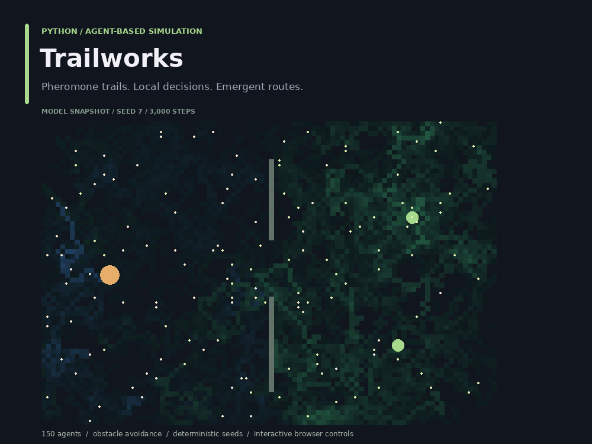

# Trailworks: ant colony laboratory



A complete Python agent-based foraging simulation with a local browser canvas interface. No external packages or build step are required. Requires Python 3.10+ and a modern browser.

## Run

```bash
cd ant-colony
python3 server.py
```

Open http://127.0.0.1:8000. Use Run/Pause, single-step, and speed controls. Population, seed, and evaporation apply on reset. Click an open cell away from the nest to add 200 food units. The simulation starts paused. Use `python3 server.py --port 8080` to change the port. The server intentionally listens only on localhost and is a local demonstration server.

## Model and implementation

`simulation.py` owns the model; `server.py` provides a small JSON API; `static/` renders the state and controls it. Each ant stores its position, direction, carrying state, and age since its last pickup/delivery. The colony owns the seeded RNG, food quantities, obstacles, counters, and two flattened pheromone grids.

Searching ants deposit home pheromones. Returning ants deposit food pheromones. Ants choose among adjacent valid cells using weighted random choices combining directional persistence, the opposite pheromone field, and short-range food/nest sensing. Eight percent of choices use uniform exploration. Food pickup and nest delivery reverse direction and reset source age. Trail deposits weaken with time since leaving their source. Both fields evaporate each tick and are capped to prevent unbounded accumulation. Obstacles block movement and diagonal corner-cutting.

The default layout has a vertical wall with a central passage and routes around its ends. The behavior is emergent and stochastic: it does not promise shortest paths. This is a simplified educational foraging model, not a validated biological model or a classical tour-solving ant colony optimization implementation. There is no global food-target steering.

Time per tick is O(grid cells + ants × food sources), with a constant eight candidate moves per ant. Memory is O(grid cells + ants + food sources). Snapshots transmit full fields for simplicity; large-scale deployments would benefit from sparse updates and a different server architecture. The default UI advances five steps per frame. Performance depends on the machine; no throughput claim is made.

## Verification

```bash
python3 -m unittest discover -s tests -v
node --check static/app.js
python3 benchmark.py --steps 3000 --population 150
```

The benchmark outputs runtime, food deliveries, and conservation checks using a deterministic seed. Tests cover seeded reproducibility, resource conservation, valid positions, pickup/delivery, evaporation, and input validation.

## API

- `GET /api/state`: complete snapshot.
- `POST /api/step`: `{ "steps": 5 }` (1–20).
- `POST /api/reset`: `{ "seed": 7, "population": 150, "evaporation": 0.025 }`.
- `POST /api/food`: `{ "x": 30, "y": 30 }`.

Requests from the UI are serialized. The server has one shared simulation and processes requests sequentially. Do not expose it as a multi-user production service.

